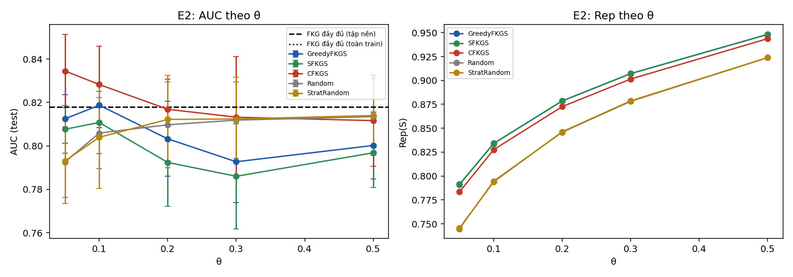
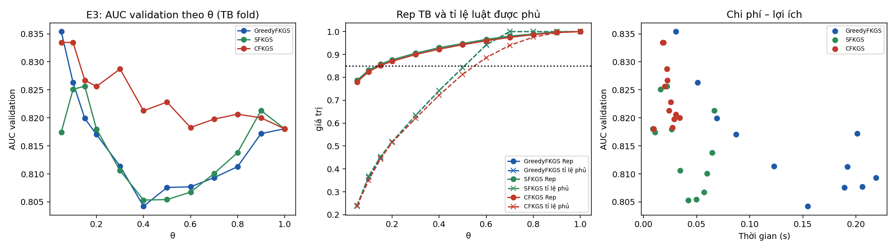
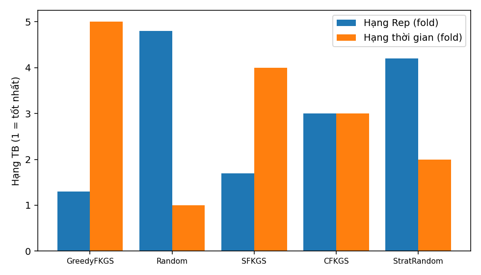

# Báo cáo thực nghiệm FKGS v3 — bộ dữ liệu `heart`

| Mục | Giá trị |
|---|---|
| run_id | `20261023T135603-b9455fdf` |
| Mã nguồn (SHA-256 tổng hợp) | `b2f66e1e147afe73…` |
| Dữ liệu | real `data/heart/Data.csv` SHA-256 `948420b084d8a3a0…` |
| Tiền xử lý | 918 dòng → 918 sau loại 0 trùng; nhãn {'0': 410, '1': 508}; X trùng khác nhãn: 0 |
| Chia dữ liệu | 5-fold phân tầng, seed 42; tập nền N_EXP=1500 |
| Điền giá trị thiếu | trung vị toàn cục của train (chỉ X), cùng quy tắc train/test |
| Nhân Sim / Rep | 1−Hamming cùng nhãn, −1 khác nhãn; Rep dùng max(0,Sim) |
| Mờ hoá | 3 mức theo phân vị [0.333, 0.667] của tập huấn luyện |
| FISA-P | PAIR_SCOPE=`global`; điểm s = log D1 − log D0; quyết định `calibrated` (tiêu chí `bacc`, tập xác thực 0.2 tập huấn luyện) |
| Ngân sách | `exact` (mọi phương pháp chọn đúng ceil(θn) luật) |
| Môi trường | Python 3.13.16, numpy 2.1.3, scipy 1.16.3, sklearn 1.6.1, Linux-6.6.122+-x86_64-with-glibc2.39 |
| Chế độ | đầy đủ |

## E1 — Kiểm chứng cận lý thuyết (RQ1)

120 mẫu con từ luật huấn luyện fold 0 (vét cạn). Cận 1−1/e = 0.6321.

| n | m | m/n thực | Greedy ρ TB / min | SFKGS Rep/OPT_pb min | SFKGS tỉ lệ cục bộ min | SFKGS max\|g\| | CFKGS Rep/OPT_pb min | CFKGS min g |
|---|---|---|---|---|---|---|---|---|
| 10 | 2 | 0.200 | 1.0000 / 1.0000 | 0.9687 | 0.9688 | 2.2e-16 | 1.0000 | 1.1e-16 |
| 10 | 4 | 0.400 | 0.9959 / 0.9762 | 0.9762 | 0.9677 | 2.2e-16 | 1.0000 | 0.0e+00 |
| 14 | 3 | 0.214 | 0.9966 / 0.9717 | 0.9717 | 0.9559 | 2.2e-16 | 1.0388 | 2.6e-02 |
| 14 | 6 | 0.429 | 0.9976 / 0.9917 | 0.9917 | 0.9815 | 2.2e-16 | 0.9916 | 0.0e+00 |
| 18 | 4 | 0.222 | 0.9968 / 0.9790 | 0.9856 | 0.9804 | 1.1e-16 | 1.0000 | 1.1e-16 |
| 18 | 7 | 0.389 | 0.9969 / 0.9760 | 0.9811 | 0.9811 | 2.2e-16 | 0.9936 | 1.1e-16 |

Số vi phạm: greedy=0, sfkgs=0, cfkgs=0, sfkgs_decomposition=0, cfkgs_negative_g=0, chain=0, classdev_sfkgs=0, classdev_cfkgs=0, greedy_above_opt=0, size_mismatch=0

## E2 — So sánh với FKG đầy đủ và lấy mẫu cơ sở, cùng ngân sách (RQ2)

Đơn vị suy luận: fold (n = số fold); Random/StratRandom lấy trung bình theo hạt giống trong fold. Các fold có tập huấn luyện chồng lấp nên p-value mang tính mô tả trong phạm vi bộ dữ liệu.

| Mốc | \|R\| | AUC | Balanced Acc | Accuracy | Acc (argmax) | BalAcc (argmax) |
|---|---|---|---|---|---|---|
| FKG đầy đủ (tập nền) | 587 | 0.8180 ± 0.0197 | 0.7637 | 0.7636 | 0.6677 | 0.6368 |
| FKG đầy đủ (toàn train) | 587 | 0.8180 ± 0.0197 | 0.7637 | 0.7636 | 0.6677 | 0.6368 |

| θ | Phương pháp | \|S\| | Rep | Tỉ lệ luật phủ (≥δ) | AUC | Accuracy | Balanced Acc | Lớp+ trong mẫu | t chọn (s) |
|---|---|---|---|---|---|---|---|---|---|
| 0.05 | GreedyFKGS | 30 | 0.7912 ± 0.0016 | 0.246 | 0.8125 ± 0.0112 | 0.7527 | 0.7490 | 0.540 | 0.036 |
| 0.05 | SFKGS | 30 | 0.7909 ± 0.0016 | 0.242 | 0.8077 ± 0.0110 | 0.7397 | 0.7375 | 0.567 | 0.010 |
| 0.05 | CFKGS | 30 | 0.7833 ± 0.0019 | 0.236 | 0.8345 ± 0.0168 | 0.7712 | 0.7728 | 0.567 | 0.017 |
| 0.05 | Random | 30 | 0.7447 ± 0.0012 | 0.142 | 0.7926 ± 0.0163 | 0.7434 | 0.7395 | 0.551 | 0.000 |
| 0.05 | StratRandom | 30 | 0.7455 ± 0.0011 | 0.138 | 0.7931 ± 0.0197 | 0.7428 | 0.7390 | 0.567 | 0.000 |
| 0.1 | GreedyFKGS | 59 | 0.8341 ± 0.0011 | 0.364 | 0.8187 ± 0.0103 | 0.7626 | 0.7547 | 0.536 | 0.046 |
| 0.1 | SFKGS | 59 | 0.8339 ± 0.0013 | 0.363 | 0.8108 ± 0.0144 | 0.7636 | 0.7578 | 0.559 | 0.013 |
| 0.1 | CFKGS | 59 | 0.8276 ± 0.0019 | 0.359 | 0.8283 ± 0.0178 | 0.7745 | 0.7653 | 0.559 | 0.014 |
| 0.1 | Random | 59 | 0.7946 ± 0.0010 | 0.250 | 0.8059 ± 0.0163 | 0.7542 | 0.7488 | 0.554 | 0.000 |
| 0.1 | StratRandom | 59 | 0.7938 ± 0.0008 | 0.246 | 0.8040 ± 0.0235 | 0.7507 | 0.7467 | 0.559 | 0.000 |
| 0.2 | GreedyFKGS | 118 | 0.8785 ± 0.0005 | 0.523 | 0.8032 ± 0.0172 | 0.7517 | 0.7482 | 0.547 | 0.092 |
| 0.2 | SFKGS | 118 | 0.8786 ± 0.0006 | 0.525 | 0.7924 ± 0.0202 | 0.7408 | 0.7407 | 0.551 | 0.027 |
| 0.2 | CFKGS | 118 | 0.8726 ± 0.0009 | 0.524 | 0.8169 ± 0.0139 | 0.7636 | 0.7598 | 0.551 | 0.016 |
| 0.2 | Random | 118 | 0.8458 ± 0.0007 | 0.416 | 0.8097 ± 0.0197 | 0.7586 | 0.7531 | 0.554 | 0.000 |
| 0.2 | StratRandom | 118 | 0.8463 ± 0.0005 | 0.418 | 0.8122 ± 0.0203 | 0.7622 | 0.7557 | 0.551 | 0.000 |
| 0.3 | GreedyFKGS | 177 | 0.9071 ± 0.0005 | 0.638 | 0.7927 ± 0.0188 | 0.7484 | 0.7430 | 0.527 | 0.120 |
| 0.3 | SFKGS | 177 | 0.9072 ± 0.0004 | 0.640 | 0.7860 ± 0.0242 | 0.7386 | 0.7354 | 0.554 | 0.034 |
| 0.3 | CFKGS | 177 | 0.9015 ± 0.0007 | 0.634 | 0.8132 ± 0.0279 | 0.7734 | 0.7683 | 0.554 | 0.017 |
| 0.3 | Random | 177 | 0.8781 ± 0.0009 | 0.540 | 0.8119 ± 0.0176 | 0.7623 | 0.7564 | 0.552 | 0.000 |
| 0.3 | StratRandom | 177 | 0.8786 ± 0.0009 | 0.543 | 0.8124 ± 0.0193 | 0.7627 | 0.7567 | 0.554 | 0.000 |
| 0.5 | GreedyFKGS | 294 | 0.9482 ± 0.0008 | 0.850 | 0.8002 ± 0.0154 | 0.7571 | 0.7542 | 0.546 | 0.173 |
| 0.5 | SFKGS | 294 | 0.9482 ± 0.0009 | 0.851 | 0.7968 ± 0.0159 | 0.7527 | 0.7480 | 0.554 | 0.048 |
| 0.5 | CFKGS | 294 | 0.9437 ± 0.0006 | 0.825 | 0.8116 ± 0.0210 | 0.7658 | 0.7574 | 0.554 | 0.020 |
| 0.5 | Random | 294 | 0.9239 ± 0.0004 | 0.722 | 0.8135 ± 0.0177 | 0.7677 | 0.7618 | 0.554 | 0.000 |
| 0.5 | StratRandom | 294 | 0.9239 ± 0.0003 | 0.723 | 0.8140 ± 0.0185 | 0.7668 | 0.7612 | 0.554 | 0.000 |

Kiểm định Wilcoxon một phía (phương pháp > đối chứng), đơn vị fold, Holm trong từng họ (độ đo × đối chứng):

| Độ đo | Đối chứng | θ | Phương pháp | Chênh TB | CI95 (t) | Fold tốt hơn | Tỉ lệ seed bị vượt | p | p Holm |
|---|---|---|---|---|---|---|---|---|---|
| rep | Random | 0.05 | GreedyFKGS | +0.0465 | [0.0449; 0.0480] | 5/5 | 1.00 | 0.0312 | 0.4688 |
| rep | Random | 0.05 | SFKGS | +0.0462 | [0.0446; 0.0478] | 5/5 | 1.00 | 0.0312 | 0.4688 |
| rep | Random | 0.05 | CFKGS | +0.0386 | [0.0371; 0.0401] | 5/5 | 1.00 | 0.0312 | 0.4688 |
| rep | Random | 0.1 | GreedyFKGS | +0.0395 | [0.0381; 0.0409] | 5/5 | 1.00 | 0.0312 | 0.4688 |
| rep | Random | 0.1 | SFKGS | +0.0393 | [0.0376; 0.0411] | 5/5 | 1.00 | 0.0312 | 0.4688 |
| rep | Random | 0.1 | CFKGS | +0.0329 | [0.0307; 0.0352] | 5/5 | 1.00 | 0.0312 | 0.4688 |
| rep | Random | 0.2 | GreedyFKGS | +0.0327 | [0.0316; 0.0337] | 5/5 | 1.00 | 0.0312 | 0.4688 |
| rep | Random | 0.2 | SFKGS | +0.0327 | [0.0314; 0.0340] | 5/5 | 1.00 | 0.0312 | 0.4688 |
| rep | Random | 0.2 | CFKGS | +0.0267 | [0.0256; 0.0279] | 5/5 | 1.00 | 0.0312 | 0.4688 |
| rep | Random | 0.3 | GreedyFKGS | +0.0289 | [0.0277; 0.0302] | 5/5 | 1.00 | 0.0312 | 0.4688 |
| rep | Random | 0.3 | SFKGS | +0.0290 | [0.0276; 0.0305] | 5/5 | 1.00 | 0.0312 | 0.4688 |
| rep | Random | 0.3 | CFKGS | +0.0233 | [0.0217; 0.0250] | 5/5 | 1.00 | 0.0312 | 0.4688 |
| rep | Random | 0.5 | GreedyFKGS | +0.0243 | [0.0230; 0.0256] | 5/5 | 1.00 | 0.0312 | 0.4688 |
| rep | Random | 0.5 | SFKGS | +0.0243 | [0.0228; 0.0258] | 5/5 | 1.00 | 0.0312 | 0.4688 |
| rep | Random | 0.5 | CFKGS | +0.0199 | [0.0189; 0.0208] | 5/5 | 1.00 | 0.0312 | 0.4688 |
| rep | StratRandom | 0.05 | GreedyFKGS | +0.0457 | [0.0447; 0.0467] | 5/5 | 1.00 | 0.0312 | 0.4688 |
| rep | StratRandom | 0.05 | SFKGS | +0.0454 | [0.0444; 0.0464] | 5/5 | 1.00 | 0.0312 | 0.4688 |
| rep | StratRandom | 0.05 | CFKGS | +0.0378 | [0.0358; 0.0398] | 5/5 | 1.00 | 0.0312 | 0.4688 |
| rep | StratRandom | 0.1 | GreedyFKGS | +0.0403 | [0.0394; 0.0413] | 5/5 | 1.00 | 0.0312 | 0.4688 |
| rep | StratRandom | 0.1 | SFKGS | +0.0401 | [0.0387; 0.0415] | 5/5 | 1.00 | 0.0312 | 0.4688 |
| rep | StratRandom | 0.1 | CFKGS | +0.0338 | [0.0319; 0.0356] | 5/5 | 1.00 | 0.0312 | 0.4688 |
| rep | StratRandom | 0.2 | GreedyFKGS | +0.0322 | [0.0312; 0.0332] | 5/5 | 1.00 | 0.0312 | 0.4688 |
| rep | StratRandom | 0.2 | SFKGS | +0.0323 | [0.0311; 0.0335] | 5/5 | 1.00 | 0.0312 | 0.4688 |
| rep | StratRandom | 0.2 | CFKGS | +0.0263 | [0.0251; 0.0275] | 5/5 | 1.00 | 0.0312 | 0.4688 |
| rep | StratRandom | 0.3 | GreedyFKGS | +0.0284 | [0.0271; 0.0298] | 5/5 | 1.00 | 0.0312 | 0.4688 |
| rep | StratRandom | 0.3 | SFKGS | +0.0285 | [0.0273; 0.0298] | 5/5 | 1.00 | 0.0312 | 0.4688 |
| rep | StratRandom | 0.3 | CFKGS | +0.0228 | [0.0220; 0.0237] | 5/5 | 1.00 | 0.0312 | 0.4688 |
| rep | StratRandom | 0.5 | GreedyFKGS | +0.0242 | [0.0232; 0.0253] | 5/5 | 1.00 | 0.0312 | 0.4688 |
| rep | StratRandom | 0.5 | SFKGS | +0.0243 | [0.0231; 0.0255] | 5/5 | 1.00 | 0.0312 | 0.4688 |
| rep | StratRandom | 0.5 | CFKGS | +0.0198 | [0.0188; 0.0208] | 5/5 | 1.00 | 0.0312 | 0.4688 |
| auc | Random | 0.05 | GreedyFKGS | +0.0198 | [0.0032; 0.0365] | 5/5 | 0.63 | 0.0312 | 0.4688 |
| auc | Random | 0.05 | SFKGS | +0.0151 | [0.0034; 0.0267] | 5/5 | 0.60 | 0.0312 | 0.4688 |
| auc | Random | 0.05 | CFKGS | +0.0419 | [0.0220; 0.0617] | 5/5 | 0.81 | 0.0312 | 0.4688 |
| auc | Random | 0.1 | GreedyFKGS | +0.0128 | [0.0005; 0.0252] | 5/5 | 0.69 | 0.0312 | 0.4688 |
| auc | Random | 0.1 | SFKGS | +0.0049 | [-0.0093; 0.0191] | 2/5 | 0.53 | 0.4062 | 1.0000 |
| auc | Random | 0.1 | CFKGS | +0.0224 | [0.0060; 0.0387] | 5/5 | 0.75 | 0.0312 | 0.4688 |
| auc | Random | 0.2 | GreedyFKGS | -0.0065 | [-0.0243; 0.0113] | 2/5 | 0.35 | 0.9062 | 1.0000 |
| auc | Random | 0.2 | SFKGS | -0.0173 | [-0.0438; 0.0092] | 1/5 | 0.23 | 0.9688 | 1.0000 |
| auc | Random | 0.2 | CFKGS | +0.0071 | [-0.0013; 0.0156] | 4/5 | 0.63 | 0.0625 | 0.6250 |
| auc | Random | 0.3 | GreedyFKGS | -0.0192 | [-0.0365; -0.0018] | 0/5 | 0.13 | 1.0000 | 1.0000 |
| auc | Random | 0.3 | SFKGS | -0.0258 | [-0.0493; -0.0024] | 0/5 | 0.08 | 1.0000 | 1.0000 |
| auc | Random | 0.3 | CFKGS | +0.0013 | [-0.0137; 0.0164] | 2/5 | 0.51 | 0.5938 | 1.0000 |
| auc | Random | 0.5 | GreedyFKGS | -0.0133 | [-0.0241; -0.0025] | 0/5 | 0.11 | 1.0000 | 1.0000 |
| auc | Random | 0.5 | SFKGS | -0.0167 | [-0.0272; -0.0061] | 0/5 | 0.05 | 1.0000 | 1.0000 |
| auc | Random | 0.5 | CFKGS | -0.0019 | [-0.0129; 0.0092] | 3/5 | 0.46 | 0.6875 | 1.0000 |
| auc | StratRandom | 0.05 | GreedyFKGS | +0.0194 | [0.0078; 0.0310] | 5/5 | 0.66 | 0.0312 | 0.4688 |
| auc | StratRandom | 0.05 | SFKGS | +0.0146 | [-0.0061; 0.0353] | 4/5 | 0.59 | 0.0625 | 0.7500 |
| auc | StratRandom | 0.05 | CFKGS | +0.0414 | [0.0243; 0.0585] | 5/5 | 0.83 | 0.0312 | 0.4688 |
| auc | StratRandom | 0.1 | GreedyFKGS | +0.0148 | [-0.0024; 0.0319] | 4/5 | 0.64 | 0.0625 | 0.7500 |
| auc | StratRandom | 0.1 | SFKGS | +0.0068 | [-0.0125; 0.0261] | 3/5 | 0.52 | 0.1562 | 1.0000 |
| auc | StratRandom | 0.1 | CFKGS | +0.0243 | [0.0046; 0.0440] | 5/5 | 0.79 | 0.0312 | 0.4688 |
| auc | StratRandom | 0.2 | GreedyFKGS | -0.0090 | [-0.0281; 0.0102] | 1/5 | 0.32 | 0.9062 | 1.0000 |
| auc | StratRandom | 0.2 | SFKGS | -0.0198 | [-0.0505; 0.0109] | 1/5 | 0.21 | 0.9688 | 1.0000 |
| auc | StratRandom | 0.2 | CFKGS | +0.0047 | [-0.0057; 0.0150] | 3/5 | 0.60 | 0.2188 | 1.0000 |
| auc | StratRandom | 0.3 | GreedyFKGS | -0.0197 | [-0.0384; -0.0010] | 0/5 | 0.09 | 1.0000 | 1.0000 |
| auc | StratRandom | 0.3 | SFKGS | -0.0264 | [-0.0517; -0.0010] | 0/5 | 0.05 | 1.0000 | 1.0000 |
| auc | StratRandom | 0.3 | CFKGS | +0.0008 | [-0.0154; 0.0171] | 2/5 | 0.47 | 0.5938 | 1.0000 |
| auc | StratRandom | 0.5 | GreedyFKGS | -0.0138 | [-0.0245; -0.0030] | 0/5 | 0.11 | 1.0000 | 1.0000 |
| auc | StratRandom | 0.5 | SFKGS | -0.0171 | [-0.0287; -0.0056] | 0/5 | 0.05 | 1.0000 | 1.0000 |
| auc | StratRandom | 0.5 | CFKGS | -0.0023 | [-0.0124; 0.0078] | 3/5 | 0.44 | 0.6875 | 1.0000 |
| auc | FKG_full_pool | 0.05 | GreedyFKGS | -0.0055 | [-0.0204; 0.0093] | 2/5 | — | 0.7812 | 1.0000 |
| auc | FKG_full_pool | 0.05 | SFKGS | -0.0103 | [-0.0240; 0.0034] | 1/5 | — | 0.9688 | 1.0000 |
| auc | FKG_full_pool | 0.05 | CFKGS | +0.0165 | [-0.0010; 0.0340] | 4/5 | — | 0.0625 | 0.9375 |
| auc | FKG_full_pool | 0.1 | GreedyFKGS | +0.0007 | [-0.0115; 0.0129] | 2/5 | — | 0.5938 | 1.0000 |
| auc | FKG_full_pool | 0.1 | SFKGS | -0.0072 | [-0.0223; 0.0079] | 2/5 | — | 0.7812 | 1.0000 |
| auc | FKG_full_pool | 0.1 | CFKGS | +0.0103 | [-0.0058; 0.0263] | 4/5 | — | 0.0938 | 1.0000 |
| auc | FKG_full_pool | 0.2 | GreedyFKGS | -0.0147 | [-0.0268; -0.0027] | 0/5 | — | 1.0000 | 1.0000 |
| auc | FKG_full_pool | 0.2 | SFKGS | -0.0256 | [-0.0501; -0.0011] | 1/5 | — | 0.9688 | 1.0000 |
| auc | FKG_full_pool | 0.2 | CFKGS | -0.0011 | [-0.0119; 0.0096] | 3/5 | — | 0.5000 | 1.0000 |
| auc | FKG_full_pool | 0.3 | GreedyFKGS | -0.0253 | [-0.0441; -0.0065] | 0/5 | — | 1.0000 | 1.0000 |
| auc | FKG_full_pool | 0.3 | SFKGS | -0.0320 | [-0.0542; -0.0097] | 0/5 | — | 1.0000 | 1.0000 |
| auc | FKG_full_pool | 0.3 | CFKGS | -0.0048 | [-0.0216; 0.0120] | 2/5 | — | 0.9062 | 1.0000 |
| auc | FKG_full_pool | 0.5 | GreedyFKGS | -0.0178 | [-0.0305; -0.0051] | 0/5 | — | 1.0000 | 1.0000 |
| auc | FKG_full_pool | 0.5 | SFKGS | -0.0212 | [-0.0332; -0.0091] | 0/5 | — | 1.0000 | 1.0000 |
| auc | FKG_full_pool | 0.5 | CFKGS | -0.0064 | [-0.0127; 0.0000] | 0/5 | — | 1.0000 | 1.0000 |

## E3 — Đường cong theo θ, chọn θ* trên validation (RQ3)

θ* = điểm gối trên mặt Pareto (chi phí = chọn luật + xây FISA + suy diễn; lợi ích = AUC validation). Test chỉ dùng để đánh giá tại θ*. Ngưỡng Rep trung bình = 0.85; phủ toàn phần = mọi luật có cov ≥ 0.85.

| Phương pháp | θ* theo fold | \|S\| TB tại θ* | AUC test tại θ* | Acc / BalAcc test tại θ* | AUC test FKG đầy đủ | Acc / BalAcc FKG đầy đủ | θ nhỏ nhất Rep TB ≥ ngưỡng | θ nhỏ nhất phủ toàn phần |
|---|---|---|---|---|---|---|---|---|
| GreedyFKGS | 0.05, 0.05, 0.05, 0.1, 0.1 | 42 | 0.8162 ± 0.0090 | 0.7604 / 0.7518 | 0.8180 | 0.7636 / 0.7637 | 0.15, 0.15, 0.15, 0.15, 0.15 | 0.7, 0.7, 0.7, 0.7, 0.7 |
| SFKGS | 0.2, 0.05, 0.05, 0.1, 0.1 | 59 | 0.8041 ± 0.0097 | 0.7397 / 0.7350 | 0.8180 | 0.7636 / 0.7637 | 0.15, 0.15, 0.15, 0.15, 0.15 | 0.7, 0.7, 0.7, 0.7, 0.7 |
| CFKGS | 0.1, 0.2, 0.05, 0.1, 0.05 | 59 | 0.8286 ± 0.0151 | 0.7756 / 0.7694 | 0.8180 | 0.7636 / 0.7637 | 0.2, 0.15, 0.15, 0.15, 0.15 | 1.0, 1.0, 1.0, 1.0, 1.0 |

## E4 — So sánh các chiến lược tại θ = 0.2, cùng ngân sách (RQ4)

| Phương pháp | \|S\| | Rep TB ± ĐLC | Tỉ lệ luật phủ | Lớp+ | Thời gian (ms) |
|---|---|---|---|---|---|
| GreedyFKGS | 100 | 0.8727 ± 0.0020 | 0.496 | 0.542 | 48.9 |
| Random | 100 | 0.8397 ± 0.0036 | 0.396 | 0.559 | 0.1 |
| SFKGS | 100 | 0.8726 ± 0.0020 | 0.497 | 0.550 | 15.7 |
| CFKGS | 100 | 0.8669 ± 0.0021 | 0.496 | 0.550 | 12.0 |
| StratRandom | 100 | 0.8400 ± 0.0038 | 0.398 | 0.550 | 0.2 |

**Rep, 5 block = trung bình fold (chính):** Friedman χ²=18.707, p=8.97e-04, CD=2.728 (5 block). Hạng: GreedyFKGS=1.30, Random=4.80, SFKGS=1.70, CFKGS=3.00, StratRandom=4.20. Cặp khác biệt: GreedyFKGS–Random, GreedyFKGS–StratRandom, Random–SFKGS

**Rep, 50 block (mô tả, có điều kiện trên fold):** Friedman χ²=183.588, p=1.26e-38, CD=0.863 (50 block). Hạng: GreedyFKGS=1.46, Random=4.53, SFKGS=1.54, CFKGS=3.00, StratRandom=4.47. Cặp khác biệt: GreedyFKGS–Random, GreedyFKGS–CFKGS, GreedyFKGS–StratRandom, Random–SFKGS, Random–CFKGS, SFKGS–CFKGS, SFKGS–StratRandom, CFKGS–StratRandom

**Thời gian, trung bình fold:** Friedman χ²=20.000, p=4.99e-04, CD=2.728 (5 block). Hạng: GreedyFKGS=5.00, Random=1.00, SFKGS=4.00, CFKGS=3.00, StratRandom=2.00. Cặp khác biệt: GreedyFKGS–Random, GreedyFKGS–StratRandom, Random–SFKGS

## PUB — Giao thức của bài công bố: chia cố định 70/30, FKG đầy đủ

Độ chính xác đã công bố của FKG đầy đủ: None. Ngưỡng hiệu chỉnh được chọn trên tập xác thực tách 20% từ tập huấn luyện; tập kiểm tra 30% không tham gia chọn ngưỡng.

| FISA | Mờ hoá | Số seed | AUC | Acc argmax | BalAcc argmax | Acc (D0>9·D1) | Acc hiệu chỉnh (tiêu chí Acc) | BalAcc hiệu chỉnh (tiêu chí BalAcc) | Độ nhạy / Độ đặc hiệu (hiệu chỉnh BalAcc) |
|---|---|---|---|---|---|---|---|---|---|
| gốc (tổ hợp ba) | q10/q90 | 1 | 0.8067 | 0.5652 ± 0.0000 | 0.5122 | 0.5543 | 0.7174 ± 0.0000 | 0.7068 | 0.804 / 0.610 |
| gốc (tổ hợp ba) | tam phân vị | 5 | 0.8980 | 0.8304 ± 0.0197 | 0.8214 | 0.5775 | 0.8304 ± 0.0141 | 0.8298 | 0.876 / 0.784 |
| FISA-P (cặp) | q10/q90 | 5 | 0.8009 | 0.5551 ± 0.0016 | 0.5008 | 0.5543 | 0.7478 ± 0.0374 | 0.7139 | 0.719 / 0.709 |
| FISA-P (cặp) | tam phân vị | 5 | 0.8257 | 0.6725 ± 0.0182 | 0.6407 | 0.5543 | 0.7594 ± 0.0438 | 0.7129 | 0.675 / 0.751 |
